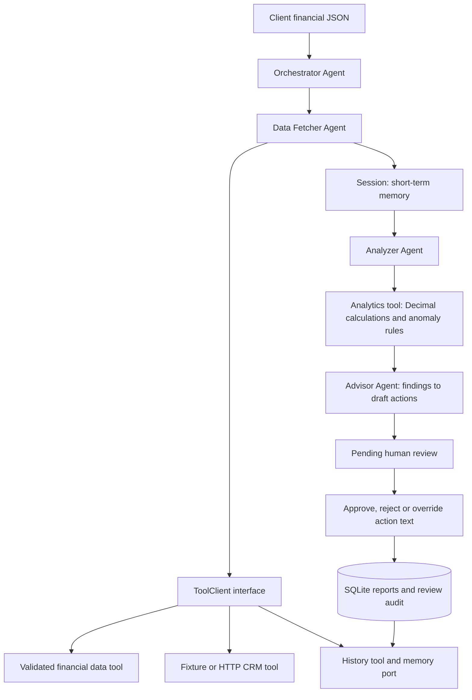

# Wealth Advisor Assistant

A small multi-agent system that turns client JSON and CRM context into an evidence-backed advisory draft. It detects unusual outflows, spending increases, liquidity gaps and portfolio risk signals, then waits for a human to approve or reject the draft.

The default runs locally with Python 3.11+ and **no runtime dependencies, credentials or network access**. A separate mock HTTP CRM demonstrates real API integration, including timeouts, retries and degraded operation.

This is a simulation for the assignment. Agent decisions use an explicit, deterministic policy. There is no live LLM call; `reasoning_mode` identifies this in every successful report. The interfaces allow an LLM-backed advisor to be added without moving financial calculations into a language model.

## Run in two minutes

From the repository root:

```bash
python3 -m wealth_advisor analyze --input samples/client.json --output output/draft.json
```

On Windows, use `python` instead of `python3`. No installation is required. To install the console command in a virtual environment:

```bash
python3 -m venv .venv
source .venv/bin/activate
python -m pip install --no-deps -e .
wealth-advisor analyze --input samples/client.json
```

PowerShell activation: `.venv\Scripts\Activate.ps1`.

Analysis writes JSON to stdout, structured execution logs to stderr, and a durable report to `data/memory.sqlite3`. `--output` also writes the JSON atomically to a file. Run IDs and execution times change between runs; the financial results are deterministic for the same inputs, policy and memory.

For an isolated demo that generates both a normal draft and a CRM-outage draft:

```bash
python3 scripts/demo.py
```

The script prints a review command and saves artifacts in a fresh `output/demo-*` directory. It leaves the draft pending for you to inspect.

## Expected sample results

The supplied fictional client has USD 212,000 in assets, USD 30,000 in liabilities, USD 182,000 net worth and two months of declared expense coverage. The investment portfolio is 90% equities, with 70% of its value in one fund.

With a fresh memory database the agents produce eight findings:

| Signal | Evidence |
| --- | --- |
| Low liquidity | USD 12,000 cash / USD 6,000 monthly expenses = 2 months; demo target is 6 |
| Concentration | One fund holds USD 140,000 / USD 200,000 invested assets = 70% |
| Risk profile mismatch | 90% equity exposure exceeds the moderate profile's demo limit of 65% |
| Large outflow | USD 15,000 withdrawal exceeds the USD 10,000 review threshold |
| Unusual transaction | USD 1,800 grocery outflow against a USD 100 historical median |
| Grocery spending increase | USD 800 in August to USD 2,100 in September |
| Dining spending increase | USD 400 in August to USD 1,200 in September |
| Limited statistical coverage | Some categories have fewer than eight baseline transactions |

The USD 25,000 internal transfer and salary receipts are excluded from outflow detection. These flags request investigation; they do not establish fraud or recommend a trade.

Inspect [samples/output.json](samples/output.json) for the complete output, [samples/crm_outage_output.json](samples/crm_outage_output.json) for the fallback, [samples/historical_output.json](samples/historical_output.json) for an earlier-snapshot comparison, and [samples/reviewed_output.json](samples/reviewed_output.json) for an illustrative human decision. All use synthetic data. Regenerate them with `python3 scripts/generate_examples.py`.

## Human review

Every completed analysis starts with `status: pending_review`, `advisory_release_allowed: false`, and no `reviewed_actions`. Copy the `run_id` from the output and inspect the report before recording your decision:

```bash
python3 -m wealth_advisor inspect RUN_ID
python3 -m wealth_advisor review RUN_ID --decision approve --reviewer "Alex Advisor" --notes "Validated transaction records and confirmed the cash requirement."
```

Use `--decision reject` to keep release blocked. To replace one action's wording during approval:

```bash
python3 -m wealth_advisor review RUN_ID --decision approve --reviewer "Alex Advisor" --notes "Reviewed the client's planned withdrawal." --override "A-LARGE_OUTFLOW-TRANSACTION_HASH=Confirm the planned withdrawal date with the client."
```

Replace the example action ID with an actual `actions[].id` from the draft. Use `--db PATH` on all commands when using a nondefault database.

SQLite records one final decision per run in a transaction, including reviewer, rationale, timestamp and action overrides. Approval exposes `reviewed_actions` and enables release; rejection exposes no reviewed actions. Original findings, metrics and draft actions remain intact. An invalid or competing review cannot overwrite the recorded decision. To correct a finalized draft, run a new analysis and review it.

The gate controls this application's release state. Reviewer names are self-declared in this local demonstration, and a user with filesystem access can edit the database. Authentication and tamper-resistant storage would be needed for a shared service. A human override changes action text only; it cannot change financial evidence or the recorded suitability guardrail.

## Architecture and agent flow



The orchestrator schedules agents whose declared dependencies are satisfied, records each step and catches unrecoverable failures. It can accept agents in any order; an unsatisfied dependency plan fails explicitly.

| Component | Responsibility |
| --- | --- |
| `OrchestratorAgent` | Routes work, creates per-run state, handles failure boundaries and persists the draft |
| `DataFetcherAgent` | Loads and validates financial JSON, fetches CRM context, retrieves earlier summaries |
| `AnalyzerAgent` | Calls the analytics tool and records evidence-backed findings |
| `AdvisorAgent` | Selects proposed follow-up actions and suppresses portfolio-change discussion when CRM context is unsuitable |
| `ToolClient` / `Tool` | Separate agent requests from implementations |
| `ToolRegistry` | Executes tools, logs outcomes, classifies errors and retries transient failures |
| `Session` | Holds one run's normalized data, findings, actions, warnings and execution trace |
| `Memory` / `SQLiteMemory` | Store original reports, retrieve earlier summaries, and audit final reviews |

Only the CLI composition root selects concrete adapters. Agents have no filesystem, HTTP or SQL calls. The analytics implementation is also behind a tool, so it can be replaced or run remotely. No agent framework is required for the small, fixed workflow.

The modules are under `wealth_advisor/`; tests are under `tests/`. `scripts/demo.py` exercises the same system as the CLI.

## Real HTTP tool demonstration

Start the mock API in one terminal:

```bash
python3 -m wealth_advisor serve-crm --port 8765
```

In a second terminal:

```bash
python3 -m wealth_advisor analyze --input samples/client.json --crm-url http://127.0.0.1:8765
```

Endpoints are `GET /health` and `GET /clients/{client_id}`. The server binds to loopback. Start it with `--failure-mode unavailable` to return HTTP 503, or `--failure-mode malformed` to return an invalid profile. You can also exercise the fallback without a server:

```bash
python3 -m wealth_advisor analyze --input samples/client.json --simulate-crm-failure --output output/outage.json
```

The HTTP adapter uses a two-second socket timeout, a 64 KiB response cap, response validation and no redirects. Set `--crm-timeout` to a value above zero and at most 30 seconds. Transient connection errors and HTTP 408/429/500/502/503/504 receive at most three attempts with 50 ms and 100 ms backoff. Missing profiles, bad schemas and other HTTP errors are not retried. This is a bounded demo retry policy; production clients should honor `Retry-After` and enforce a whole-operation deadline.

## Input contract and assumptions

[samples/client.json](samples/client.json) is the full input example. Required top-level fields are `client_id`, `as_of`, `history_start`, `currency`, `cash_balance`, `monthly_income`, `monthly_expenses`, `liabilities`, `holdings` and `transactions`.

- Monetary values are nonnegative decimal strings, with at most two decimal places and a maximum of 10^15 per value. JSON numbers are accepted, but strings preserve the sender's intended decimal precision. Calculations use `Decimal`; output decimals are strings.
- Amounts use a single normalized currency. Explicitly mismatched transaction or holding currencies are rejected. This demo assumes two-decimal accounting units; it does not perform FX conversion.
- Transaction amounts are magnitudes. `kind` supplies direction: `expense`, `withdrawal`, `income`, `refund`, or `internal_transfer`. Internal transfers, income and refunds do not count as outflows. Refunds are not netted against category expenses.
- Every transaction has a unique `id`, a date within `history_start` through `as_of`, a category and a counterparty. Duplicate IDs fail validation, so rerun imports do not silently double-count them.
- `history_start` asserts complete transaction coverage from that date. The system cannot verify that assertion against an external ledger. Monthly growth analysis requires coverage of both full months.
- Holdings have unique `asset_id` values, a market value and an `asset_class`: `equity`, `bonds`, `property`, or `alternative`. Cash is recorded only in `cash_balance`; holdings should exclude it.
- Cash, investments and liabilities form a supplied snapshot. Transactions are not applied to the balances again. Declared monthly expenses and income may differ from the transaction sample; the surplus is labeled accordingly.
- The `as_of` date anchors all windows. The system rejects future-dated transactions and CRM snapshots newer than that date. No analysis decision depends on the computer's current date.
- CRM must match the client ID and contain risk tolerance, investment horizon, verification status and snapshot date. Profiles older than 180 days or without verified KYC block portfolio discussion.

Unrecognized input fields are ignored. Missing required fields fail validation. Empty holdings and transaction arrays are allowed and produce coverage limitations rather than invented observations. Financial files are capped at 10 MB, with at most 100,000 transactions and 10,000 holdings.

## Analysis policy

Thresholds live in `AnalysisPolicy` and appear in report metrics with a policy version. They are illustrative settings, not validated suitability or anti-fraud rules.

- Recent outflows cover `as_of - 30 days` through `as_of`, inclusive. The baseline uses the preceding 90 days and never includes a scored transaction. It is grouped by category.
- A category needs at least eight baseline outflows for statistical detection. A recent amount is unusual if it is strictly greater than `max(500, 4 * median, median + 6 * 1.4826 * MAD)`. MAD is the median absolute deviation. The absolute floor and ratio guard handle a constant baseline and tiny normal purchases.
- Any recent outflow of at least 10,000 triggers an absolute review flag, even with no baseline. That transaction does not receive a second statistical flag.
- Category expenses are compared across the two most recent complete calendar months. Growth must exceed 50% and increase by at least 500. A zero previous total does not support a percentage-growth claim.
- Cash coverage below six months prompts reserve review. Negative declared cash flow and negative recorded net worth trigger separate findings. Zero expenses make coverage unknown rather than infinite.
- A holding above 40% of invested assets triggers concentration review. Equity limits are 40%, 65% and 85% for conservative, moderate and aggressive profiles. A horizon under three years caps the demo equity limit at 40%.
- When comparable earlier memory exists, a net worth decline of more than 20% requests reconciliation. It does not attribute the decline to market performance.

Finding IDs remain stable for the same rule and entity. Actions cite finding IDs, and findings contain source transaction IDs or snapshot measurements. Severity indicates review priority, not a calibrated probability of fraud or loss.

## Memory, failures and observability

SQLite stores full original reports and final review records. History queries return up to five summaries for the same client and currency, strictly before the current `as_of`, newest first. Rejected reports are excluded. Pending reports may supply observed metrics; their proposed actions are never reused as facts. The latest summary supplies the historical comparison. Same-day reruns do not become their own baseline, and future snapshots cannot leak into earlier analysis.

| Failure | Result |
| --- | --- |
| Missing file, invalid JSON, invalid amounts, duplicate IDs or unsupported currencies | Structured failed report, no advisory actions, exit 1 |
| CRM outage, missing client, invalid or future CRM response | Limited draft, explicit warning, no assumed risk profile, portfolio discussion blocked |
| Historical memory unavailable | Current-data analysis continues with a warning |
| Report cannot be persisted | Draft returned with `memory_persisted: false`; release remains blocked and review requires a rerun after storage recovery |
| Analytics or agent failure, unsatisfied dependencies | Structured failure with no partial actions |
| Invalid review or final decision already recorded | Command error, exit 2, original decision preserved |

Successful drafts, including degraded drafts, exit 0. Operational failures exit 1; invalid commands and review/storage errors exit 2. Argument-parser usage errors also exit 2. A missing finding does not prove that a transaction or portfolio is safe.

JSON logs include run ID, routing decisions, tool attempts, error codes, elapsed time, finding counts and fallback decisions. They exclude raw inputs, transaction details, client IDs and freeform review notes. Reports and the local database do contain financial data; keep runtime files out of version control. `.gitignore` excludes `data/`, `output/`, environment files and SQLite files.

## Tests

```bash
python3 -m unittest discover -s tests -v
```

The suite covers hand-calculated financial results, statistical and absolute thresholds, flat baselines, temporal coverage, currency and identity validation, actual loopback HTTP requests, retries, fallbacks, memory isolation, review overrides, immutable originals, concurrent decisions, and CLI JSON/log separation. CI runs the tests on Python 3.11, 3.12 and 3.13 on Linux, plus Python 3.12 on Windows. CI configuration is included; local verification is documented in [docs/validation.md](docs/validation.md).

## Decisions and trade-offs

Deterministic agents keep the demonstration reproducible and make each decision inspectable. They satisfy the assignment's simulation scope, but do not provide an open-ended LLM planner. A next step would be a schema-constrained narrative agent behind a reasoning port, with citation validation, tool allowlists, a turn budget and evaluations for unsupported advice. Credentials and live model calls are outside this implementation.

The dependency scheduler runs sequentially because the workflow is small and analysis needs prepared data. It avoids framework overhead and concurrent state mutation. Independent fetches could run concurrently behind the same interfaces.

SQLite provides transactions and useful local persistence without a service to configure. A shared deployment would need authenticated review, access controls, encryption, retention rules, migrations and a suitable database. The tool registry currently retries read-only operations; adding write tools would require idempotency controls.

The anomaly policy favors explanations over statistical sophistication. It can miss unusual timing, split transactions, new categories below the absolute threshold and gradual changes. It does not calibrate thresholds by currency, model seasonality, or infer missing records. Historical value changes may reflect deposits, withdrawals or data coverage, so actions ask for reconciliation.

## Repository submission

The repository includes runnable source, mock API, synthetic input/output, tests, CI and this architecture/run guide. Runtime databases and generated files are ignored. A local initial Git commit is sufficient to inspect the submission; to share it remotely, create a GitHub repository and push the `main` branch, then grant the evaluator access if it is private.
