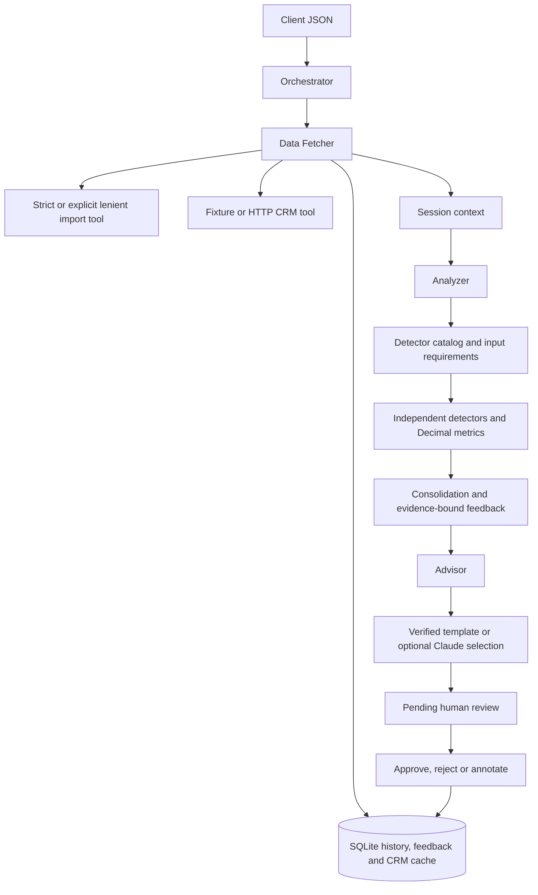

# Wealth Advisor Assistant

A local multi-agent simulation that turns client JSON and CRM context into a financial review draft. Three specialized agents prepare data, run independent checks, and propose evidence-backed follow-up actions. An orchestrator manages their dependencies, tool permissions, failures and execution trace. Every draft requires human approval before release.

Python 3.11+ is sufficient. The default uses **no runtime dependencies, credentials or external network access**. You can exercise real HTTP integration with the bundled mock CRM. Optional Claude sentence selection demonstrates a constrained LLM tool with a local template fallback.

This is an assignment demonstration using synthetic data and illustrative thresholds. The system does not execute transactions or provide autonomous investment decisions.

## License and evaluation

Version 0.2.0 is provided under the standard, unmodified
[PolyForm Free Trial License 1.0.0](LICENSE). It permits evaluation on behalf of
an individual or company for **less than 32 consecutive calendar days**, including
changes for that evaluation. It does not grant permission to redistribute the
software or a general license for ongoing production or business use.

For a longer evaluation or use outside that grant, obtain separate written
permission from [Luthfi Naufan Yamin](https://github.com/luthfiny). This is
source-available assessment software, not an open-source release. See
[COPYRIGHT](COPYRIGHT) and [licensing details](docs/licensing.md). Earlier MIT
releases retain their original licensing.

## Run

From the repository root:

```bash
python3 -m wealth_advisor analyze --input samples/client.json --output output/draft.json
```

On Windows, use `python` instead of `python3`. Installation is optional:

```bash
python3 -m venv .venv
source .venv/bin/activate
python -m pip install --no-deps -e .
wealth-advisor analyze --input samples/client.json
```

PowerShell activation: `.venv\Scripts\Activate.ps1`.

JSON results go to stdout, JSONL logs to stderr, and durable drafts to `data/memory.sqlite3`. `--output` writes an additional atomic JSON export. Use `--db PATH` for an isolated memory store. A fresh demo directory can also be generated with `python3 scripts/demo.py`.

The original sample produces eight findings, USD 182,000 net worth and two months of declared expense coverage. It flags liquidity, concentration, equity exposure, a large withdrawal, an unusual grocery payment and two category spending increases. The eighth finding explains limited statistical coverage. A new-counterparty signal corroborates the withdrawal without creating a duplicate action. Internal transfers, refunds and salary receipts are excluded from expense and withdrawal anomaly checks.

Inspect the generated examples:

| File | Demonstration |
| --- | --- |
| [samples/output.json](samples/output.json) | Original sample draft, coverage and tool trace |
| [samples/reviewed_output.json](samples/reviewed_output.json) | Synthetic approval with a human action override |
| [samples/crm_outage_output.json](samples/crm_outage_output.json) | Explicit cache fallback with portfolio discussion blocked |
| [samples/historical_output.json](samples/historical_output.json) | Comparison with an earlier snapshot |
| [samples/batch_output.json](samples/batch_output.json) | Balanced client, unusual activity and an imported-data repair case |

Run IDs and timings vary. Calculations are deterministic for the same data, policy and applicable memory.

## Architecture



| Component | Responsibility |
| --- | --- |
| `OrchestratorAgent` | Schedules agents by declared dependencies; records routing, completion and failure; persists the draft |
| `DataFetcherAgent` | Validates input, retrieves CRM context and historical memory, and records import quality and source provenance |
| `AnalyzerAgent` | Makes one analytics request and applies eligible reviewer feedback; the detector registry owns selection, coverage and signal consolidation |
| `AdvisorAgent` | Maps findings to investigation actions, enforces portfolio discussion guards and requests a cited narrative |
| `Tool` / `ToolClient` / `ToolProvider` | Separate tool implementations, narrow agent calls and the orchestrator's ability to create scoped clients |
| `ToolRegistry` | Enforces per-agent allowlists; returns structured results with attempts, duration and error kind; applies retries, deadlines and circuit breakers |
| `Session` | Short-term memory for one execution, including prepared data, signals, decisions and tool metadata |
| `SQLiteMemory` | Stores immutable drafts, final review decisions, earlier summaries, feedback and dated CRM snapshots |

The composition root is `wealth_advisor/runtime.py`. Agents do not make raw filesystem, HTTP or SQL calls. Tools remain replaceable, and a new detector needs a catalog entry rather than changes to the orchestration flow. A detector exception records a sanitized failure and lets the other checks finish. An invalid financial snapshot fails the run with no advisory actions.

The registry validates finding fields, evidence and unique IDs before publishing a
detector's results. Invalid output fails only that check. Statistical and absolute
outflow checks run independently; overlapping signals are consolidated afterward.
The advisor computes one portfolio guard with explicit blocker reasons, which both
action wording and the report use. Reviewer feedback cannot clear guards based on
original evidence.

These are deterministic task agents with explicit capabilities and dependency contracts. A small fixed workflow does not require an orchestration framework. Keeping financial calculations and action selection deterministic makes the result inspectable and runnable offline. The optional model has a deliberately narrow role.

## Checks and financial assumptions

```bash
python3 -m wealth_advisor checks
python3 -m wealth_advisor tools
```

The catalog contains 18 detectors:

| Checks | Inputs and behavior |
| --- | --- |
| Liquidity, cash flow, balance sheet | Snapshot balances and declared monthly income/expenses; zero expenses produce unknown runway and a data-collection action |
| Concentration, suitability, CRM context | Holding values, risk tolerance, horizon, verification and profile age; unsuitable or unavailable context blocks portfolio discussion |
| Baseline coverage, large outflows, statistical outflows | Absolute amount rules plus category median/MAD and ratio checks; statistics require enough earlier observations |
| Spending growth, income drop | Two complete covered calendar months; compare receipts or expense categories rather than partial months |
| Historical comparison | Earlier same-client, same-currency, nonrejected snapshots; same-day and future snapshots are excluded |
| New counterparty | High-value outflows to counterparties absent from a sufficiently populated earlier baseline |
| Duplicate charges | Equal expense amounts and counterparties within a configured timestamp window |
| Transaction velocity, odd hours | Outflow bursts and overnight activity using supplied timezone offsets |
| Foreign activity | High-value outflows outside the home country and countries observed in the earlier baseline |
| Structuring pattern | Repeated cash movements in an illustrative amount range and date window; requests manual investigation without alleging wrongdoing |

The report lists `executed_checks`, `skipped_checks` with reasons, and `failed_checks`. Missing timestamps or channels cause the relevant checks to skip. An absent flag is inconclusive when its check did not run. `execution_status: completed` means the configured workflow finished; inspect coverage separately.

`detector_signals` retains all emitted signals. `raw_findings` consolidates overlapping single-transaction signals before reviewer feedback. `findings` contains the active findings after eligible feedback; suppressed evidence remains in `suppressed_findings`. Group patterns retain their own transaction lists. Correlation across group patterns is still possible.

All monetary arithmetic uses `Decimal`, serialized as strings. Inputs must supply nonnegative amounts with at most two decimal places and explicit transaction kinds. Liabilities are a separate positive balance. All records use one currency; FX conversion requires a separate adapter. Net worth uses the supplied snapshot, not a reconstruction from transaction history. `history_start` asserts coverage and cannot prove the feed is complete.

`review_priority` is an **uncalibrated triage heuristic**, not a fraud probability or investment risk rating. Its score is `round(100 * (1 - product(1 - severity_weight)))` with critical/high/medium/info weights of 0.30/0.15/0.08/0.01. Bands are low below 20, moderate below 40, elevated below 65, and high thereafter. Related signals can affect the score; it must not drive automatic decisions.

## Configuration and batch runs

Load the versioned example settings explicitly:

```bash
python3 -m wealth_advisor --config config/settings.json analyze --input samples/client.json
```

Unspecified settings use defaults. Unknown fields, bad types, nonfinite values, excessive decimal precision and inconsistent threshold relationships fail before execution. `enabled_checks: null` enables the full catalog; a list selects specific names. Deliberately omitted checks appear in coverage. Reports include the effective configuration and a policy fingerprint for auditing. Configuration contains no credentials.

Process multiple clients while isolating failures:

```bash
python3 -m wealth_advisor batch --input-dir samples/clients --crm-fixture samples/crm_batch.json --ingestion-mode lenient --output-dir output/batch --output output/batch-summary.json
```

Use `--input file1.json file2.json` instead of `--input-dir` for explicit paths. Batch execution is sequential and shares backend circuit state and memory; it continues after a failed client. Each report has its own run ID and review gate. Exit code 1 indicates a failed client or individual export. Code 2 indicates a command/configuration error; degraded but reviewable drafts return 0.

Strict ingestion is the default. In the supplied batch, strict mode rejects `import_repairs.json` while processing the other clients. Explicit lenient mode normalizes conventional thousands separators, labels missing nonfinancial transaction fields, drops invalid transactions and deduplicates identical transaction IDs. It records each change and a heuristic quality score. Missing balances, invalid holdings, conflicting duplicate IDs and mixed currencies remain fatal. Any repair or dropped record degrades the run and blocks portfolio discussion.

Optional transaction fields are `timestamp` (ISO 8601 with an offset, matching `date`), `country` (two uppercase letters) and `channel` (`card`, `bank_transfer`, `cash`, `other`). Optional client `home_country` supports the country check. The contrasting fixtures include all these fields. The timestamp offset represents recorded transaction time; it does not establish the client's location.

## Human review and reusable feedback

Every draft starts with `status: pending_review` and `advisory_release_allowed: false`. Copy its run ID:

```bash
python3 -m wealth_advisor inspect RUN_ID
python3 -m wealth_advisor review RUN_ID --interactive
```

Or record a decision through flags:

```bash
python3 -m wealth_advisor review RUN_ID --decision approve --reviewer "Alex Advisor" --notes "Checked the snapshot and supporting records." --dismiss "F-LOW_LIQUIDITY=Planned cash requirement confirmed" --severity "F-SINGLE_ASSET_CONCENTRATION=info"
```

Use actual finding IDs from the draft. `--override "ACTION_ID=Replacement instruction"` edits an action's wording, and `--decision reject` keeps release blocked. `--feedback-ttl-days` changes annotation validity. Specify `--db PATH` consistently if using a custom store.

For a file-based decision:

```json
{
  "decision": "approve",
  "reviewer": "Alex Advisor",
  "notes": "Checked supporting records and the planned cash requirement.",
  "dismissals": {"F-LOW_LIQUIDITY": "Planned cash requirement confirmed"},
  "severity_overrides": {},
  "overrides": {},
  "ttl_days": 90
}
```

```bash
python3 -m wealth_advisor review RUN_ID --decisions decision.json
```

SQLite commits the final decision and annotations together. Concurrent or repeated reviewers cannot replace it. Approval exposes `reviewed_findings`, `reviewed_actions`, `reviewed_priority` and a regenerated `reviewed_narrative`. Rejection exposes no reviewed actions or narrative. Original metrics, evidence, actions and draft narrative remain available. Make a new run to revise a finalized decision.

Approved dismissals and severity overrides can apply to a later run only when client, currency, finding identity, full evidence fingerprint and policy fingerprint match. Validity expires after the configured number of days measured from the source snapshot's `as_of`. Same-day/future source snapshots are excluded. Changed evidence or policy resurfaces the finding and records the reason. Action-text overrides apply only to the reviewed run. Reusable feedback never approves the next draft or clears guards based on original CRM or detector evidence.

This is a local checkpoint: reviewer names are self-declared, and a user with filesystem access can edit SQLite. A shared service would need authenticated reviewers, access controls and tamper-resistant auditing.

## HTTP integration and resilience

Start the loopback mock API in one terminal:

```bash
python3 -m wealth_advisor serve-crm --port 8765
```

In another terminal:

```bash
python3 -m wealth_advisor analyze --input samples/client.json --crm-url http://127.0.0.1:8765
```

The adapter calls `GET /clients/{client_id}` and validates client identity and profile dates. The server also exposes `/health`. Restart with `--failure-mode unavailable` for HTTP 503, or `--failure-mode malformed` for invalid profile data. Fixture-only outage simulation uses `analyze --input samples/client.json --simulate-crm-failure`.

Transient failures retry with bounded exponential backoff. Invalid data and not-found responses do not retry. HTTP responses are capped at 64 KiB, redirects are blocked, and the adapter uses native socket timeouts with a shared monotonic call budget. A backend circuit opens after four consecutive failed calls by default, then permits one recovery probe after cooldown. Circuits are process-local; batch runs demonstrate reuse across clients. A bounded semaphore limits concurrent tool executions without spawning abandoned timeout threads.

CRM and the optional Claude adapter share the bounded HTTP response reader in
`wealth_advisor/http_transport.py`. Each adapter owns its request schema and error
mapping; byte limits, redirect policy and read budgets have one implementation.

Deadlines are cooperative. Native HTTP reads use the remaining budget; synchronous local Python functions are checked after returning and cannot be forcibly preempted. DNS resolution and OS scheduling can exceed a nominal socket budget. A hard process-isolation timeout would require a different execution model.

Healthy CRM responses create dated cache snapshots. An outage may use a same-client snapshot only if its observation is no later than the analysis date, within the cache age limit, and its profile is still within the policy's freshness bound. A not-found response never falls back to cache. Cache use is explicit and always keeps portfolio discussion blocked. History/feedback/storage failures produce warnings and conservative fallbacks; an unsaved draft cannot be reviewed.

Logs include run IDs, agent routing, decisions, tool attempts/durations and error categories. They omit raw financial payloads, client IDs and reviewer text. Reports contain sensitive source information and need suitable storage protections outside this synthetic demo.

## Optional Claude tool

Set `ANTHROPIC_API_KEY` in the launching environment, then enable the optional tool:

```bash
python3 -m wealth_advisor analyze --input samples/client.json --llm
```

The adapter uses the [Anthropic Messages API](https://platform.claude.com/docs/en/api/messages/create). The configurable default model is `claude-haiku-4-5`. Only opaque finding IDs, rule codes and severity labels leave the process. The model selects up to three IDs; local code renders their verified sentences and citations. It cannot introduce amounts, recommendations or freeform prose into the report. Invalid selections, malformed responses, provider errors, missing credentials and timeouts fall back to the template with a warning. Calculations, actions and review requirements remain deterministic.

The adapter has mocked contract and failure tests. No paid live-provider call is part of validation. A production assessment would still need model evaluations, provider monitoring and a privacy review. This narrow selector demonstrates tool integration; it is not a general conversational or autonomous LLM agent.

## Validate and regenerate examples

For the optional local MCP plugin, installation and live protocol validation, see
[docs/plugin.md](docs/plugin.md). The base CLI still has no runtime dependencies;
the `mcp` extra installs the pinned MCP SDK only when requested.

```bash
python3 -W error::ResourceWarning -m unittest discover -s tests -q
python3 scripts/validate.py
python3 scripts/fuzz.py --cases 800 --seed 20261015
python3 scripts/generate_examples.py
python3 scripts/generate_scenarios.py
```

The unit suite checks financial boundaries, independent detector failures, permission enforcement, circuit recovery, concurrent reviews, dated cache behavior, feedback expiry, import repairs and constrained narrative selection. The process runner exercises fresh CLI processes and real loopback HTTP CRM servers. The seeded fuzz run alternates strict and lenient imports and checks that corrupted requests cannot crash the system or bypass review.

[docs/validation.md](docs/validation.md) records verified local environments and results. The included CI workflow covers Linux Python 3.11–3.13 and Windows Python 3.12. Lint/format checks use Ruff 0.17.0. Check the submission repository's Actions page for remote CI results.

The design favors an auditable assignment-sized system. SQLite and sequential batch execution suit a local demonstration; multi-user service deployment would need stronger authentication, storage concurrency planning and operational controls. There is no market-data feed, RAG corpus, FX conversion, authenticated enterprise CRM or trade execution in this scope.
